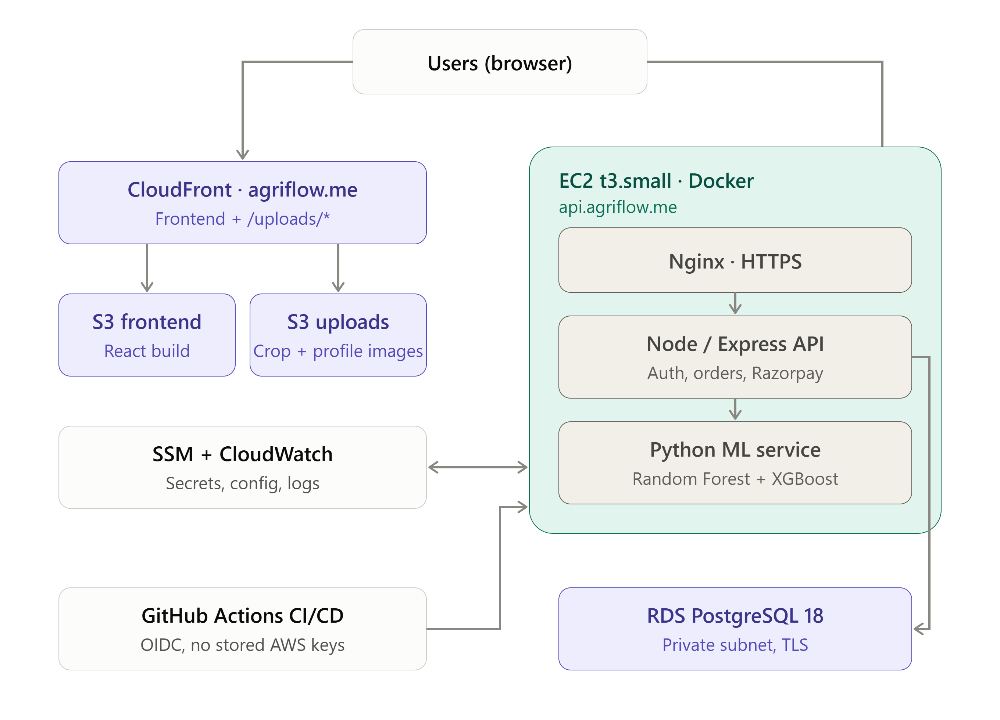

# Agriflow Monorepo

Full stack marketplace for agriculture: backend API, web frontend, mobile app, and ML service.

**Live:** https://agriflow.me · **API health:** https://api.agriflow.me/api/health

## Tech Stack

- Backend: Node.js + Express + PostgreSQL
- Frontend: React + Vite
- Mobile: Expo (React Native)
- ML Service: Flask

## Prerequisites

- Node.js 18+ (npm)
- Python 3.10+
- PostgreSQL
- Git
- Expo Go app (for mobile testing)

## Environment Setup

Create local env files from the examples:

```bash
# from repo root
cp backend/.env.example backend/.env
cp frontend/.env.example frontend/.env
cp mobile/.env.example mobile/.env
cp ml_service/.env.example ml_service/.env
```

Windows PowerShell:

```powershell
Copy-Item backend\.env.example backend\.env
Copy-Item frontend\.env.example frontend\.env
Copy-Item mobile\.env.example mobile\.env
Copy-Item ml_service\.env.example ml_service\.env
```

Update `backend/.env` with your PostgreSQL connection string and secrets.

## Install Dependencies

If you use a virtual environment for Python, activate it before installing ML dependencies.

```bash
# backend
cd backend
npm install

# frontend
cd ../frontend
npm install

# mobile
cd ../mobile
npm install

# ml service
cd ../ml_service
pip install -r requirements.txt
```

## Run the Project (local dev)

Start services in this order:

```bash
# 1) ML service (port 5001)
cd ml_service
python app.py

# 2) Backend API (port 5000)
cd ../backend
npm run dev

# 3) Web frontend (port 5173)
cd ../frontend
npm run dev

# 4) Mobile app
cd ../mobile
npx expo start
```

## Shared API Config

Each app reads its API URL from its own env file, falling back to `http://localhost:5000/api` ([shared/apiConfig.ts](shared/apiConfig.ts)):

- Web: `VITE_API_URL` in `frontend/.env` (see `frontend/.env.example`)
- Mobile: `EXPO_PUBLIC_API_URL` in `mobile/.env` (see `mobile/.env.example`)

## Database

Create a database and set `DATABASE_URL` in `backend/.env`.

Example (psql):

```sql
CREATE DATABASE agriflow;
```

## Optional: ngrok

If you expose the backend with ngrok, set `VITE_API_URL` / `EXPO_PUBLIC_API_URL` to `<tunnel URL>/api` and add the web app's origin to `ALLOWED_ORIGINS` in `backend/.env`.

## Troubleshooting

- Port already in use: change the service port in its `.env` file or stop the process using that port.
- CORS errors: ensure `ALLOWED_ORIGINS` in `backend/.env` includes your frontend URL (e.g., `http://localhost:5173`).
- API not reachable from mobile: set `EXPO_PUBLIC_API_URL` in `mobile/.env` to your LAN IP (e.g. `http://192.168.1.10:5000/api`; see `mobile/.env.example`) and restart Expo.

## Folder Overview

- backend
- frontend
- mobile
- ml_service
- shared

## Deployment (AWS)



- **Frontend:** React build on S3, served by CloudFront at `agriflow.me` (HTTPS via ACM).
- **API:** Docker Compose on EC2 (t3.small): Nginx with Let's Encrypt HTTPS → Node/Express API → Python ML service (Random Forest + XGBoost). Domain `api.agriflow.me` via Route 53.
- **Data:** RDS PostgreSQL 18 (not publicly accessible, TLS); ML models loaded from S3 at startup.
- **Images:** uploaded directly from the browser to a private S3 bucket using presigned POST (type and 5 MB size enforced by S3), served through CloudFront at `/uploads/*`.
- **Config and logs:** secrets in SSM Parameter Store, container logs in CloudWatch, EC2 managed via Session Manager (no SSH).
- **CI/CD:** GitHub Actions with OIDC (no stored AWS keys). Pushes to `main` redeploy the backend via SSM Run Command or rebuild the frontend to S3 with a CloudFront invalidation.

## Performance

Measured with k6 load tests (50 concurrent users, 60 s runs, median of 3) against PostgreSQL seeded with 10,000 orders and 2,000 crops, all on localhost. ML rows: median of 200 sequential requests, median of 3 runs.

Admin orders and ML rows: before = commit `2e2a563`, after = commit `e3e1155` (includes `0f151ee`).
`/api/crops` rows: before = commit `e3e1155`, after = commit `f0d1acd` (includes `5c82e11`), run back-to-back on a freshly re-seeded database.
Same seeded data volumes and hardware throughout.

| Metric | Before | After |
|---|---:|---:|
| `/api/admin/orders` p95 latency | 20.5 s | 974 ms (21.1× faster) |
| `/api/admin/orders` throughput | 4.9 req/s | 81.5 req/s |
| `/api/admin/orders` error rate | 38.7% | 0% |
| `/api/admin/orders` response size | 6.4 MiB | 13 KiB |
| `/api/crops` p95 latency | 3.93 s | 455 ms (8.6× faster) |
| `/api/crops` throughput | 19.0 req/s | 261.3 req/s |
| `/api/crops` error rate | 47.3% | 0% |
| `/api/crops` response size | 842 KiB | 8.5 KiB |
| Price prediction, median latency | 738.7 ms | 183.8 ms (4.0× faster) |
| Demand prediction, median latency | 15.8 ms | 5.2 ms (3.0× faster) |

- **Server-side pagination (LIMIT/OFFSET)** on the admin orders, admin crops and admin users endpoints.
- **Server-side pagination with listed-only filtering** on the public `/api/crops` endpoint: 20 listed crops per page (max 100) instead of all 2,000 crops of every status.
- **In-memory model caching** in the ML service: models load once at startup instead of on every request (both sides measured under waitress). The price model is a scikit-learn Random Forest and the demand model is XGBoost.

Raw numbers: [perf/results/summary-2026-10-13.json](perf/results/summary-2026-10-13.json). To reproduce, see [perf/README.md](perf/README.md).

### Production load test (live AWS deployment)

k6 from a laptop in Pune against `https://api.agriflow.me`: 10 concurrent browsing users (1–3 s think time) plus 1 ML price prediction per second, 3 minutes. Script: [perf/load/prod.js](perf/load/prod.js).

| Metric | Result |
|---|---:|
| Requests | 879 |
| Error rate | 0% |
| Browsing API p95 / median | 60 ms / 13 ms |
| Price prediction p95 / median | 198 ms / 172 ms |

Raw numbers: [perf/results/prod-2026-10-27.json](perf/results/prod-2026-10-27.json).
